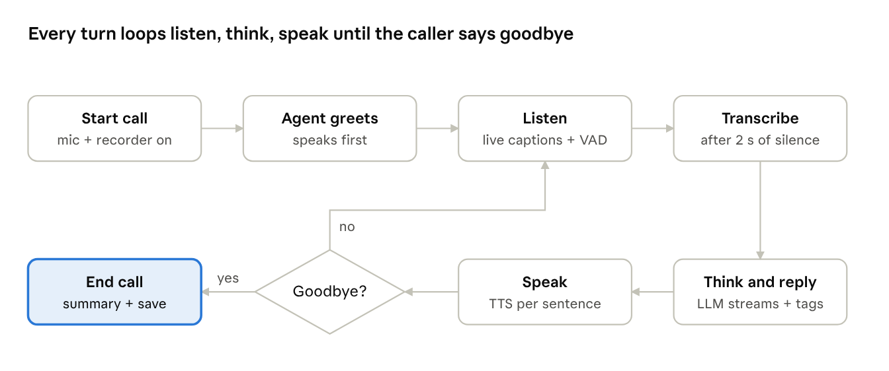
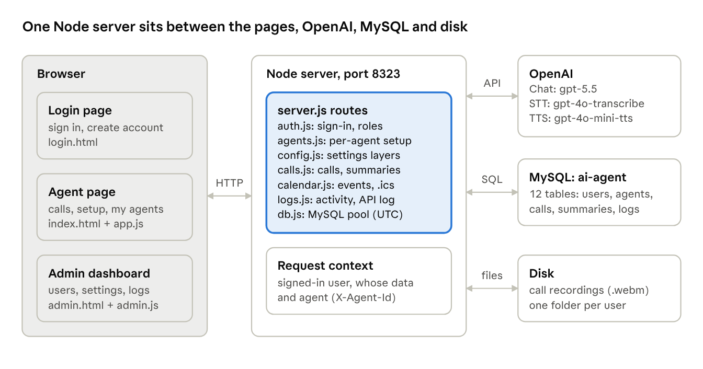

# TelemuneSmartAi — Product & Technical Guide

18 Nov 2026 · Dhananjay · Version 2.1: Spring Boot backend + web frontend, clean main page with a My agents menu, agent templates, availability, caller messages

## Contents

1. [Overview](#overview)
2. [Getting started](#getting-started)
3. [Accounts, roles and sign-up](#accounts-roles-and-sign-up)
4. [Agents](#agents)
5. [Main page and the My agents menu](#main-page-and-the-my-agents-menu)
6. [Making a call](#making-a-call)
7. [After the call: summaries, recordings and history](#after-the-call-summaries-recordings-and-history)
8. [Admin dashboard](#admin-dashboard)
9. [Data and storage](#data-and-storage)
10. [How it works (architecture)](#how-it-works-architecture)
11. [Settings, security and troubleshooting](#settings-security-and-troubleshooting)

## Overview

TelemuneSmartAi is a web app where you talk to AI voice agents through a call button in the browser: you speak, the agent answers out loud in a natural, emotional voice, and every call ends with a summary, statistics and an optional recording.

Each person signs in with their own account and can build several agents for different jobs: a personal assistant, a call assistant that answers for someone who is busy, a hospital front desk, a bank helpline, an HR recruiter and so on. Every agent keeps its own name, voice, language, AI models, persona and greeting, script, calendar and emergency numbers. An admin sees every user, agent, call and log from one dashboard, and edits the ready-made agent types and templates.

A typical call assistant answers: *"Hello, this is Brown, DJ's assistant. DJ isn't available to take your call right now, but I can schedule a meeting or pass a message on. Which would you like?"* It then books the meeting into the calendar or takes the caller's message for DJ.

The app is two applications: a **Spring Boot backend** (Java) that holds all the logic, the database access and the OpenAI calls, and a small **web frontend** that serves the pages at http://localhost:8323 and passes every request on to the backend. All data lives in a MySQL database called `ai-agent`; OpenAI does the thinking, listening and speaking.

### Features at a glance

| Area | What you get |
| --- | --- |
| Accounts | Sign in, self sign-up (Create account), two roles: Admin and User, password change, lockout after 5 wrong tries |
| Agents | Many agents per user, 15 agent types (Call Assistant, Hospital, Banking, Real Estate, HR, Telecom, Support, Sales and more), each with ready-made templates stored in the database; switch with one click |
| Persona | Each agent says who it works for and for which organization, with a greeting from its template or its own |
| Messages | The agent takes messages for the person it works for (caller name, number, urgency, message) |
| Voice calls | Web call button, live captions, accurate speech-to-text, emotional replies, automatic hang-up when the caller says goodbye |
| Languages | 16 languages incl. English, Hindi, Bengali, Tamil, Telugu, Marathi, Gujarati, Arabic, Spanish, French, German, Portuguese, Japanese, Mandarin and Jamaican Patois |
| Voices | 10 OpenAI voices, 20 emotions chosen sentence by sentence |
| Playbooks | Ready-made call scripts per agent type, or write your own; none selected = the agent's default role |
| Insights | Per-turn caller intent, mood, language and response time |
| After the call | AI summary, downloadable summary file, transcript, recording, token and time totals |
| Calendar | Agent can book events during a call; export as .ics for Google, Outlook or Apple Calendar |
| Emergency | Keyword detection with a red banner and the right helpline number (112, 108, 100, 101, 1091, 14416 …) |
| Admin | Dashboard with totals, user management, every agent and call, agent types & templates editor, app settings, sign-in list, activity log |
| Storage | MySQL tables for users, roles, sessions, sign-in attempts, settings, agent types, templates, agents, playbooks, calls, summaries, calendar, messages and logs |
| Look | Telemune branding, light and dark theme, a moving "network" background on every page (dots joined by lines that move away from the mouse), glass cards that rise in and lift on hover, a pill-shaped menu bar, chat bubbles that pop in with typing dots while the agent thinks, a ringing Start call button, a cartoon agent with a headset on the call card: a man when the voice is marked male in the voice list (today Cedar, Ballad, Ash, Echo, Verse), otherwise a woman, switching as soon as you change the voice. New voices need no change in the web app: their label ("… (male)" / "… (female)") decides. It breathes and blinks when idle, leans in with sound waves at the ear while listening, looks up with thought bubbles while thinking, and moves its mouth with the voice while speaking; the face shows each sentence's emotion (smile, eyebrows, blush, eyes) (all motion turns off when the computer's "reduce motion" setting is on) |

## Getting started

The project is two separate applications, each in its own folder with its own settings, run script, logs and README:

| App | Folder | For | Start |
| --- | --- | --- | --- |
| Backend (API) | `voice_ai_backend/` | backend team | `./run.sh` (port 8324) |
| Web app (pages) | `voice_ai_web/` | frontend team | `./run.sh` (ports 8323 http, 8443 https) |

On one computer, `./runScript.sh` in the `voice-assistant` folder starts both; then open http://localhost:8323 in Chrome or Edge.

### What you need

| Item | Detail |
| --- | --- |
| Java | JDK 21 or newer (voice_ai_backend) |
| Maven | Builds voice_ai_backend the first time and after code changes |
| Node.js | Version 22 or newer (voice_ai_web; no packages to install) |
| openssl | Makes voice_ai_web's HTTPS certificate |
| MySQL | Version 8, running locally (the database and tables are created automatically) |
| OpenAI API key | From platform.openai.com; pays for chat, voice and transcription |
| Browser | Chrome or Edge for live captions; any browser with a microphone works for OpenAI speech-to-text |

### The backend's .env file (secrets only)

```
OPENAI_API_KEY=sk-...
MYSQL_HOST=localhost
MYSQL_PORT=3306
MYSQL_USER=root
MYSQL_PASSWORD=...
MYSQL_DATABASE=ai-agent
BACKEND_PORT=8324
BACKEND_HOST=127.0.0.1
```

Copy `voice_ai_backend/.env.example` to `voice_ai_backend/.env` and fill it in. It is never committed to git.
The web app needs no secrets: its `voice_ai_web/config.json` holds `port`, `httpsPort` and `backendUrl` (where the backend runs).

### Starting the app

1. Run `./runScript.sh`. It starts `voice_ai_backend/run.sh` (checks Java and `.env`, builds when the code changed, restarts an older copy, starts on port 8324, logs in `voice_ai_backend/logs/`) and then `voice_ai_web/run.sh` (checks Node, makes the HTTPS certificate, starts on 8323 and 8443, logs in `voice_ai_web/logs/`), and opens Chrome (`NO_OPEN=1 ./runScript.sh` skips the browser). Ctrl+C stops both. Each app can also be started on its own with `./run.sh` in its folder.
2. On every start the backend creates any missing tables, adds the ready-made agent types and templates (`voice_ai_backend/db/seed.sql`) if they're not there yet, copies the default settings from `voice_ai_backend/config.json` into the database the first time, and creates the admin account if there are no users.
3. Open http://localhost:8323. Signed-out visitors are sent to the login page.
4. Sign in as **admin / admin@123** and change the password straight away (a banner reminds you).

The page ports are in `voice_ai_web/config.json` (`port`, `httpsPort`); the backend port in `voice_ai_backend/.env` as `BACKEND_PORT`. After changing backend code, run `./run.sh` (or `./runScript.sh`) again: it rebuilds and restarts. The backend listens only on this computer by default; the browser always goes through the web app. To run the two on different servers: set `backendUrl` in the web app's config.json, and `BACKEND_HOST=0.0.0.0` plus `TRUSTED_PROXIES=<web server IP>` in the backend's `.env`.

### Opening the app from other computers (HTTPS)

Browsers only allow the **microphone** on `https://` pages or on `localhost`. So on this computer you use
`http://localhost:8323`, but other computers on the network must use **https**:

1. `voice_ai_web/run.sh` makes an HTTPS certificate for this computer once (`voice_ai_web/certs/server.crt` + `.key`, made by
   `voice_ai_web/scripts/make-cert.sh`; it covers localhost, the computer's name and its current IP addresses) and prints the
   address to share, e.g. `From other computers: https://192.168.0.100:8443`.
2. On the other computer, open that address. Someone who opens `http://192.168.0.100:8323` is sent there automatically.
3. The first time, the browser warns "Your connection is not private" because the certificate is made by this computer,
   not by a public authority. Click **Advanced → Proceed to 192.168.0.100 (unsafe)**. The page opens and the microphone works.

**To remove the warning for good**, copy `voice_ai_web/certs/server.crt` to the other computer and trust it once:

| Computer | How |
| --- | --- |
| Windows | Double-click `server.crt` → Install Certificate → Local Machine → "Place all certificates in the following store" → **Trusted Root Certification Authorities** → Finish. Restart Chrome/Edge |
| Mac | Double-click `server.crt` (opens Keychain Access, add to **System**) → double-click the certificate → Trust → "When using this certificate": **Always Trust**. Restart the browser |
| Android | Settings → Security → Encryption & credentials → Install a certificate → CA certificate → pick `server.crt` |
| iPhone / iPad | Send yourself `server.crt` (AirDrop or mail), install the profile in Settings, then Settings → General → About → Certificate Trust Settings → turn it on |

Good to know:

- **IP address changed** (e.g. a new Wi-Fi)? `voice_ai_web/run.sh` notices and makes a new certificate; computers that trusted
  the old one need the new `server.crt`. `voice_ai_web/scripts/make-cert.sh --force` makes a new one by hand.
- HTTPS port: `httpsPort` in `voice_ai_web/config.json` (8443) or `HTTPS_PORT` in `voice_ai_web/.env`. `HTTPS=off` there turns it off.
  Allow ports 8323 and 8443 in the computer's firewall if other computers can't connect.
- Over https the sign-in cookie is marked **Secure** (never sent over plain http).
- For a real server with a domain name, use a trusted certificate instead (e.g. Caddy or nginx with Let's Encrypt in
  front of port 8323); then no warnings and nothing to install anywhere.

## Accounts, roles and sign-up

Everyone must sign in, and each person sees only their own agents and calls; only an admin sees everyone.

### Two roles

| Role | Number | Lands on | Can do |
| --- | --- | --- | --- |
| Admin | 1 | Admin dashboard (`/admin.html`) | Everything a user can, plus: see every user, agent, call, summary and recording; add users, reset passwords, make admin or user, disable, delete; edit agent types and templates; change app settings; read the sign-in list and activity log |
| User | 2 | The agent page (`/`) | Create and use their own agents, playbooks, calls and calendar; change their own password |

### Signing in

1. Enter username and password on the login page. Tick **Keep me signed in** to stay signed in for 30 days; otherwise the sign-in lasts 12 hours (both adjustable by the admin).
2. Admins go to the dashboard, users go to their agents.
3. Five wrong passwords for the same username from the same computer lock it for 5 minutes. Every attempt, successful or not, is recorded in the database (`login_attempts`) and listed for the admin.
4. **Sign out** and **Change password** are in the user menu at the top right.

### Creating an account (self sign-up)

1. On the login page, open the **Create account** tab.
2. Enter full name, a username (suggested from the name; 3–32 letters, numbers, dot, dash or underscore), an optional email and a password of at least 6 characters, twice.
3. The new account is a **User** and is signed in straight away. It starts with **no agents**: the "Create your first agent" **guided tour** starts by itself, and the main page shows a **＋ Create my first agent** button.

The admin can turn self sign-up off in **Admin dashboard → App settings**; the tab then disappears. At most 5 accounts can be created per computer per hour.

### Accounts the admin creates

The admin picks name, username, role and a temporary password (a Generate button makes one and copies the details). The new user must choose their own password after first sign-in. When the admin resets a password or disables an account, that person is signed out everywhere at once.

### Safety rules built in

- Passwords are stored only as scrypt hashes, never as plain text.
- Sessions are a random token in a secure cookie; the database stores only its SHA-256 fingerprint.
- There is always at least one active admin: the last admin cannot be demoted, disabled or deleted, and admins cannot remove their own access.
- Deleting a user hides the account and frees the username, but keeps their agents, calls and recordings in the database so nothing is lost by mistake.

## Agents

An agent is one AI voice persona with its own job and setup; each user can create up to 20 (the admin sets the limit), and changing one agent never changes another agent or another user's agents.

### Agent types

The type gives the agent its default persona and greeting, and offers ready-made **templates** (persona, greeting, goal, steps, rules and summary focus). Types and templates are stored in the database (`agent_types`, `agent_templates`) and the admin can change them or add new ones; an agent uses its template live, so an edit reaches every agent using it on its next call.

| Type | Default role | Ready-made templates |
| --- | --- | --- |
| Personal Assistant | Sharp, friendly personal assistant | Daily planner, Reminders & to-dos, Message drafting |
| Call Assistant (for a person) | Someone's polite, discreet call assistant | Message & meeting desk (pre-selected), Call screening, Out of office |
| Customer Support | Patient support agent | Order issue & returns, Technical troubleshooting, Complaint handling |
| Telecom Care | Mobile network care executive | Recharge & data packs, VAS / caller tune deactivation, Network complaint |
| Hospital & Healthcare | Calm hospital front desk and patient care | OPD appointment, Lab report status, Discharge follow-up |
| Banking & Finance | Trustworthy bank service officer | Card block & dispute, Loan enquiry, Account & KYC help |
| Real Estate | Friendly property advisor (calendar on, for site visits) | Property enquiry (pre-selected), Site visit booking, Rental & tenant support, Sell or list a property |
| Sales | Friendly, non-pushy sales rep | Lead qualification, Demo booking, Upsell / renewal |
| Appointment Booking | Warm receptionist | Clinic booking, Salon booking, Reschedule / cancel |
| Payment Reminder | Polite billing reminder | Overdue bill reminder, EMI reminder |
| Feedback Survey | Upbeat survey caller | NPS survey, Post-service feedback |
| HR & Recruiting | Friendly recruiter | Candidate screening, Interview scheduling |
| Tutor & Coach | Encouraging tutor | Speaking practice, Mock interview |
| Wellness Companion | Supportive listener (not therapy) | Stress check-in, Sleep wind-down |
| Other / Custom | Helpful voice agent | Write your own |

Safety rules travel with the types: the hospital agent never diagnoses and sends chest pain or heavy bleeding to emergency; the banking agent never asks for a full card number, CVV, PIN, OTP or password.

### Creating and switching agents

1. On the main page, the **Agent for this call** dropdown switches agents. **🤖 My agents** in the menu lists them all; ★ marks the one that opens first.
2. **＋ New agent** (on the main page or in My agents) opens a step-by-step window. The numbered steps and a bar at the top show where you are; **Next →** / **← Back** move between steps, and you can click an earlier step to go back to it:
    1. **Profile**: the **Agent type** dropdown (for example Call Assistant; its description shows underneath) and **template** (the type's usual one is pre-selected, or "No template: free conversation"), a **name** (for example "Brown"), **Works for** (required for the Call Assistant), **Organization** and what it's for. A preview shows the first line the agent will say.
    2. **Voice**: language, voice (**▶** plays a short hello in that voice) and speaking speed.
    3. **Availability** (optional): days, hours and time zone when the person can take meetings.
    4. **Calendar**: switch on booking into the calendar (on by default for types that need it) and the meeting length.
    5. **Emergency** (optional): contacts (phone or email) and the words that trigger them.
    6. **Playbook** (optional): one of your saved playbooks, or none to follow the agent's template. Playbooks already used by your other agents aren't listed.
    7. **Review**: everything in one list, each with **Edit**. **✨ Create agent** then makes the agent with a progress bar (creating → opening → saving the settings → preparing its greeting → ready) and takes you to the call page with it selected.
   📚 Tutorials → **Create your first agent** walks through all seven steps.
3. Switching loads that agent's settings everywhere. Switching is locked during a call.
4. In My agents, **☆ Default** makes the agent open first next time and **🗑** deletes it (its past calls stay in Call summaries).
5. To change what an agent is, pick a new **Agent type** in **My agents → 👤 Profile**. A new type is a new job, so a dialog first shows what will be reset and asks for approval; **Cancel** changes nothing. After **Change type and reset**, the database is updated in one step: template, greeting and description go to the new type's defaults; works for, organization and availability are cleared; the playbook is removed; the calendar and emergency settings go back to the defaults. Name, language, voice, AI models and past calls are kept. If the new type works for a person, fill in **Works for**.

The app remembers the last agent each user had open. A new account starts with no agents; nothing is created for it automatically.

### What belongs to an agent and what to the user

| Belongs to each agent | Shared by all of a user's agents |
| --- | --- |
| Name, language, voice | Saved playbooks (any agent can pick one) |
| LLM, speech-to-text and text-to-speech models | Call summaries list and totals (each call is labelled with its agent) |
| Selected playbook, template, works for, organization, availability, meeting length, greeting | Calendar events (each records which agent added it) |
| Calendar on/off, emergency on/off and contacts (phone or email) | Account and password |
| Messages callers left with it | |

## Main page and the My agents menu

The menu at the top right has three buttons: **🎙 Call** (the main page), **🤖 My agents**, which opens a pop-up window over the call page to create and edit agents, and **📚 Tutorials**.

### 📚 Tutorials

**📚 Tutorials** are **guided tours**: you do each step yourself on the real page while the tour shows you where. The thing to click or fill in is highlighted, a small card says what to do, and the tour **waits for you**, moving on by itself once you've done it (for steps that only explain, press **Next**). **Back** goes one step back, **Skip tour** stops, and **Show me again** brings back a highlight you've scrolled or clicked away from. When a tour ends, the card suggests the next one.

Tours: Create your first agent, Make a call, Profile & greeting, Availability & calendar, Voice, speed & AI, Emergency contacts, Playbooks, Call summaries and Your account. Open **📚 Tutorials** to pick one; tours you've finished get a ✓. A user with no agents gets "Create your first agent" automatically the first time they sign in.

### The main page (🎙 Call)

The main page only has what you need to make a call:

1. **Agent for this call**: a dropdown at the top of the call card lists your agents ("Brown · for DJ"). ＋ creates a new one (hover it to see "Create a new agent").
2. **Start call**: the green button. Mute and record (●) sit next to it.
3. **About this agent**: a short card under it shows the basics: works for, organization, availability, language and voice, and the AI models.
4. **Playbook**: pick a script for this agent, or keep "Default: the agent's template". **✕** next to it removes the selected playbook (back to the template).
5. Small chips show whether the calendar and emergency detection are on; tap one to open that setting.
6. **✎ Edit agent** opens the agent in My agents.

On the right are the conversation and the call summaries.

### My agents (create and edit)

**🤖 My agents** opens as a pop-up window over the call page (close it with ✕, Escape or a click outside). Your agents are listed on the left (★ = the one that opens first) with **＋ New agent** below them. The selected agent's settings are on the right, under its name. The header holds **🎙 Call** (back to the main page with this agent), **☆ Default** and **🗑 Delete**.

Every change saves itself within a second: there is no Save button. A small pill in the header shows **Saving…**, then **✓ Saved**. The next reply already uses the new setup.

| Tab | What you set |
| --- | --- |
| 👤 Profile | **Agent type** (change it any time, for example Personal Assistant → Call Assistant); Template; **Works for** (required for a Call Assistant); Organization; what it's for; the first line of every call, with a live preview. Text can use `{agent}`, `{owner}` and `{org}` |
| 🧠 Voice & AI | **Speech-to-text** provider and model (OpenAI, ElevenLabs Scribe, AWS Transcribe, or browser captions) and **text-to-speech** provider and model (OpenAI, AWS Polly, ElevenLabs, Cartesia). **Language**: only the languages both providers support, the most spoken in the world first (up to 39). **Voice**: the chosen provider's voices (▶ plays a sample; the cartoon agent becomes a man or a woman to match). **Speaking speed** (🐢 Slow · Normal · Fast · 🚀 Faster, or 0.5× to 2×) and the LLM. A provider without keys on the server shows "not set up"; if one fails during a call, the agent quietly switches to OpenAI |
| 🕒 Availability | Days (tap Mon … Sun, or Weekdays / Every day), From and To time, time zone and an optional note. The agent only offers meeting times inside these hours, and says when the person is back |
| 🧰 Tools | 📅 **Calendar**: book confirmed meetings, meeting length, upcoming events with .ics export · 🚨 **Emergency contacts** by **📞 phone, 💬 WhatsApp or ✉️ email** (below) · 📘 **Playbook**: add, pick, remove · 📨 **Call summaries**: after every call send the AI summary by **WhatsApp** and/or **email** (Flash SMS comes later) |

### Playbooks

A playbook is your own script: role, goal, steps, rules and what the summary should focus on.

- With no playbook selected, the agent runs its template, or its type's default role if it has no template.
- **📘 Playbooks → ＋ Add playbook** → pick an agent type → pick a ready-made script or Custom → edit the fields → save.
- Choose the playbook for a call from the **Playbook** dropdown on the main page or in the Playbooks tab. Playbooks belong to the user, so all of their agents can use them; each agent remembers its own choice.

### Call summaries by WhatsApp and email

In **🧰 Tools → 📨 Call summaries**, switch on **WhatsApp** and/or **Email** and enter the number (with country code) or
email address (several: separate with commas). After every call the AI summary is sent there automatically, in the
background; it also stays in Call summaries as always. Email uses the Gmail account in `voice_ai_backend/keys.env`;
WhatsApp uses the Telemune WhatsApp gateway (template `ai_message_summary`). **Flash SMS** is shown and will be added later.
A channel the server isn't set up for shows "not set up on the server yet".

### Emergency contacts

In **🧰 Tools → 🚨 Emergency contacts**, turn it on and an **＋ Add emergency contact** form appears:

1. **Related to**: Ambulance, Police, Fire, Women helpline, Mental-health helpline, Child helpline, Disaster, All emergencies or Other (give it a name).
2. **Contact by**: 📞 Phone, 💬 WhatsApp or ✉️ Email.
3. **Number** or **Email**: a phone number is filled in for the chosen service (108, 100, 101, 1091, 14416, 1098, 1078, 112) and editable; for email, type the address (for example the office security desk).
4. **Keywords**: tap suggestions or type your own (for example "chest pain", "bachao", "intruder").

Adding the same service again updates it instead of duplicating it. During a call, a matching word shows a red 🚨 banner with a tap-to-call, WhatsApp-chat or email link, and the agent leads its reply with that contact. A WhatsApp or email contact also gets an **alert message from the server** (once per call): the WhatsApp emergency template, or an email saying which word was heard. The agent also spots emergencies described in other words or languages.

## Making a call

A call is a loop: the agent listens until you pause, turns your speech into text, writes a short reply and speaks it, then listens again until you say goodbye.



The agent always speaks first, and the loop repeats for every turn; saying goodbye ends the call and saves it.

### Step by step

1. **Start call.** Pick the agent in **Agent for this call**, then press the green button. The app opens the microphone, starts recording (if ● is on), clears the previous conversation and starts the visualizer.
2. **Greeting.** The agent greets you first, straight away: its greeting (and the audio) is prepared as soon as the agent is selected, so it starts speaking the moment you press Start call. It speaks in its language (a non-English greeting is translated once and remembered), for example "Hello, this is Brown, DJ's assistant. DJ isn't available to take your call right now, but I can schedule a meeting or pass a message on."
3. **Listening.** Your speech is recorded from the first word. As soon as you start talking your bubble appears in the chat with a 🎙 and ripples that grow with your voice ("Listening…"), and your words write in live (Chrome and Edge), and a voice detector checks the mic level every 50 ms.
4. **Transcribing.** After a short pause (0.4 s) the recording is already sent to OpenAI `gpt-4o-transcribe`, so the text is ready when the agent decides you've finished (after 1 second of silence; if you keep talking, that early text is thrown away). It goes with a hint about the language and the agent's last sentence so names and numbers come out right. This accurate text replaces the live words in your bubble at once; words it changed flash softly for a moment. Pure noise is ignored.
5. **Thinking.** The text goes to the agent's LLM along with the recent conversation and its instructions (role, playbook, language, calendar and emergency rules). The reply streams back word by word, and the agent starts speaking as soon as the first phrase is written (it may end at a comma).
6. **Speaking.** Each finished sentence is sent to text-to-speech in the emotion the agent chose for it and streamed: it starts playing while the audio is still arriving, in order, at the agent's speaking speed, while the next one is prepared. **You can talk over the agent:** the mic keeps listening while it speaks, and when you speak for about a third of a second it stops at once and listens (an "✋ interrupted" chip marks its reply). Your first words are kept. Tapping the avatar also interrupts. Each agent bubble ends with just the agent's name, the time and ⏱ how long until you heard it (hover it for first words / voice / full reply); meeting, message and interrupted chips still show.
7. **Goodbye.** When you clearly want to end ("bye", "that's all", "rakhta hoon" in any language), the agent says one short goodbye and hangs up by itself 0.8 seconds later. You can also press End call at any time.

### How the agent talks

- Short and human: one or two sentences, about 25 words, one question at a time.
- No bot phrases ("As an AI", "I'd be happy to assist") and no lists.
- If you correct something ("no, I meant Saturday"), the correction wins and the agent confirms it.
- If a word sounds misheard, the agent checks ("Sorry, did you say Friday?").
- It matches your language, including mixes like Hinglish, and your mood: soft when you're upset, upbeat when you're happy.

### What you see on each turn

Each of your messages gets chips for **intent** (what you want, in a few words), **mood**, **language** and **reply time**; each agent message shows the emotions used. The bar above the chat shows the latest intent, mood, language, the average reply time and the turn count. The ring around the avatar moves with your voice (green) and the agent's voice (the colour of its current emotion), with orbiting dots while it thinks.

The agent has 20 emotions: neutral, happy, excited, cheerful, calm, empathetic, sad, apologetic, encouraging, confident, serious, curious, surprised, thoughtful, concerned, reassuring, grateful, playful, urgent, proud.

### During a call, if enabled

- **Calendar**: once a booking or meeting is confirmed, the agent adds it (with the caller's name in the title), a 📅 chip appears on the reply and the event shows in the Calendar section.
- **Messages**: when the caller wants to leave a message, the agent takes their name, callback number and message, reads it back, and after they confirm saves it: a "📨 message saved for DJ" chip appears, and the message is saved with the call (in its transcript and summary file). Urgent messages are marked.
- **Emergency**: a matching keyword shows a red banner with the number to call, and the agent tells you to call it first.

- **Silence**: if you say nothing for 8 seconds, the agent checks in ("Are you still there?"). After 2 check-ins with no answer it says a short goodbye and ends the call ("no answer from the caller"). Both numbers are set in Admin → App settings.

### Four ways to talk to the agent

At the bottom of the **Conversation** area, **Talk by** offers four options. **Web call** is selected by default (its
Start call button stays on the call card). Choosing another option **ends what's running** (a call is hung up and a chat
is saved with its summary, as if you had pressed End) and **clears the conversation**, so the new channel starts empty.

| Option | How it works |
| --- | --- |
| 📞 **Web call** | The live voice call described above |
| 💬 **Live chat** | Type a message; the agent greets you and answers in text straight away (no microphone needed). **End chat** saves it to Call summaries with an AI summary, and sends the summary by WhatsApp/email if switched on |
| 🎤 **Voice chat** | **Hold** the mic button, speak, **let go**: the agent hears you (with its speech-to-text provider) and answers out loud and in text. **🎙 Mute / unmute** switches the microphone off and on; the red **End** button (shown once it has started) ends it and saves it like a call |
| WhatsApp | Pick the **country code** (🇮🇳 +91 India first, then 🇺🇸 +1, 🇦🇪 +971 …; the list is the `country_codes` table) and type the mobile number, then the message, then **Send on WhatsApp**: it goes from your WhatsApp business number through the Telemune gateway. It is sent inside the approved **Conversation Summary** template, so it arrives even if the person has never written to that number (WhatsApp drops plain typed text outside 24 hours of the person's last message) |

## After the call: summaries, recordings and history

When a call ends, the app writes an AI summary, saves the call to the database with its transcript and statistics, uploads the recording if one was made, and shows it at the top of **Call summaries**.

### The call summary

The summary is written by the chat model in fixed sections, so every call reads the same way:

- **Summary**: two or three sentences on what happened.
- **Caller intent**: the main thing the caller wanted.
- **Caller mood**: at the start and at the end.
- **Key details**: the facts that matter, focused by the playbook (for example mobile number, plan, refund reference).
- **Action items** and **Outcome**.

The downloadable summary file adds the header (call ID, agent, start time, playbook, duration, turns, average reply, languages, mood path, tokens, emergencies, calendar events, messages taken) and the full annotated transcript.

### Call summaries panel

Call summaries keeps **every kind of conversation**: 📞 web calls, 💬 live chats, 🎤 voice chats and the WhatsApp messages you send from the Conversation card. Five tiles show your totals across all your agents: records, talk time, tokens used, average reply time and recordings. Click any tile, or **Show all**, to open the list.

Filter buttons at the top of the list (**All · 📞 Calls · 💬 Live chat · 🎤 Voice chat · WhatsApp**, each with its count) show one kind at a time. Each row has a badge for its kind, the agent's name, the playbook, date, duration, turns, mood path and whether there is a recording; a WhatsApp row shows the number it went to, whether it was sent, and the message. Click a row to see the full summary, statistics, the recording player and the transcript with intent, mood, language and emotion chips; download the summary file or recording; or 🗑 delete the call (its summary and recording go with it). The list is paged, 5 calls per page by default.

### Recordings

The ● button records both sides of the call (your microphone and the agent's voice) as a .webm audio file. Recordings are stored as files on the server, one folder per user, and the database keeps their names and sizes. The upload limit is 100 MB per recording.

### Tokens and costs

Token totals count the chat replies and the summary. Text-to-speech audio is not included because OpenAI doesn't report it as tokens.

## Admin dashboard

Admins land on `/admin.html`, a single page that shows every user, every agent and every call, with tools to manage accounts and app settings. **Open my agent** at the top takes the admin to their own agents.

### Totals (top row)

Users (active and admins), agents (and per user), calls and turns, talk time, tokens, average reply time, playbooks and calendar events, recordings, new messages waiting, and templates, summed across all users.

### User cards

One card per user shows their role badge, a chip per agent (★ = default), their main LLM, a "signed up" chip for self sign-ups, calls, talk time, tokens, number of agents, and last call and sign-in times. A search box filters by name, username, email, agent name, type or model.

| Button | What it does |
| --- | --- |
| 👁 View agent & calls | Opens a side panel: every agent with its language, voice, models, playbook, calendar and emergency setup; playbooks; usage; the user's calls page by page. Click a call for its summary, transcript, recording player and downloads |
| 🔑 Reset password | Sets a new temporary password; the user is signed out and must change it |
| Make admin / Make user | Changes the role |
| ⛔ Disable / ✅ Enable | Blocks or restores sign-in; disabling signs the user out at once |
| 🗑 Delete | Hides the account (data is kept in the database) |
| ＋ Add user | Creates an account with a temporary password (no agents; the user creates their own) |

Admins can only read other users' data; they cannot change another user's agents or calls.

### Agent types & templates

The **🧩 Agent types & templates** card lists every type on the left. Pick one to edit:

- **The type**: name, icon, description, the persona used when an agent has no template, the greeting, and three switches: *Ask "works for whom?"* (makes it required), *Calendar on for new agents*, and *Available to users*.
- **Its templates**, one panel each: name, persona, greeting, goal, steps and rules (one per line), what the summary should cover, *Pre-selected for new agents* and *Available to users*. Each shows how many agents use it. Save or 🗑 delete (agents using a deleted template go back to free conversation).
- **＋ New template** and **＋ New type** add new ones.

Every greeting box shows a live example (with Brown, DJ and Telemune). In any text `{agent}` is the agent's name, `{owner}` who it works for and `{org}` the organization; a part in `[[ … ]]` is left out when a value inside it is empty, so `Thank you for calling[[ {org}]]` reads well with or without an organization.

### App settings

| Setting | Default | Meaning |
| --- | --- | --- |
| Self sign-up | On | Shows Create account on the login page |
| Session length | 12 hours | How long a sign-in lasts without Keep me signed in |
| Keep me signed in | 30 days | How long a remembered sign-in lasts |
| Agents per user | 20 | Most agents one user can create |
| Re-ask after silence (seconds) | 8 | How long the caller may stay silent before the agent checks in (0 = never) |
| Re-asks before hanging up | 2 | Check-ins with no answer before the agent says goodbye and ends the call |

Changes are saved to the database and apply immediately.

### Sign-ins

Every sign-in attempt, newest first: username, ✓ or ✕ with the reason (ok, wrong password, unknown user, disabled, locked) and the time.

### Activity log

A paged list, newest first, of who did what and when: sign-in, sign-out, failed sign-in, sign-up, password change, users added, changed or deleted, agents created, edited or deleted, agent setup changes, playbooks added or removed, calls saved or deleted, calendar events, messages taken or handled, template and type changes, and app-setting changes. Above it, a line shows API requests, errors and average response time for the last 24 hours.

## Data and storage

All data and settings live in the MySQL database `ai-agent` (16 tables); only call recordings are kept as audio files on disk.

The tables are defined in `db/schema.sql` and the ready-made types and templates in `db/seed.sql`; the backend runs both on every start (only adding what's missing). All times are stored in UTC.

### Tables

| Table | Holds | Main columns |
| --- | --- | --- |
| `roles` | The two roles | id (1 admin, 2 user), name, description |
| `users` | Accounts | id, username, name, email, role_id, password_hash, must_change_password, disabled, signup_source (setup, admin, self, import), last_login_at, deleted_at |
| `sessions` | Who is signed in | token_hash, user_id, ip, user_agent, expires_at |
| `login_attempts` | Every sign-in attempt | username, user_id, ip, user_agent, success, reason, created_at |
| `app_config` | Shared settings, one JSON document per section | section (branding, agent, models, speechToText, conversation, history, calendar, emergency, auth), value |
| `agent_types` | The agent types | type_key, name, icon, description, role (persona), greeting, needs_owner, default_calendar, sort_order, active |
| `agent_templates` | Ready-made scripts per type | id, type_key, name, role (persona), greeting, goal, steps, rules, summary_focus, is_default, active |
| `agents` | Each agent's own setup | id, user_id, name, agent_type, template_id, owner_name, organization, owner_availability, availability_plan, meeting_minutes, speech_speed, greeting, description, language, voice, chat_model, tts_model, stt_engine, stt_model, playbook_id, calendar_enabled, emergency_enabled, is_default |
| `emergency_rules` | Emergency contacts per agent | agent_id, label, contact_type (phone or email), number (or email), keywords (JSON), sort_order |
| `playbooks` | Users' saved call scripts | id, user_id, agent_type, name, role, goal, steps, rules, summary_focus |
| `calls` | Every finished call, live chat, voice chat and sent WhatsApp message (`channel`: call, chat, voice, whatsapp) | id, user_id, agent_id, agent_name, channel, started_at, ended_at, duration, turns, tokens, avg_response_ms, stats, transcript, recording file details |
| `call_summaries` | The AI summary and the full summary file text | call_id, summary, full_text |
| `calendar_events` | Events agents booked | id, user_id, agent_id, title, start_at, duration_min, notes |
| `messages` | Messages callers left | id, user_id, agent_id, agent_name, for_name, caller_name, caller_number, urgency, message, status (new, done) |
| `activity_logs` | Who did what | user_id, username, action, target, details, ip, created_at |
| `api_logs` | Every API request | user_id, agent_id, method, path, status, duration_ms, created_at |

Deleting an agent keeps its calls, events and messages (their agent link is cleared). Logs have no links to other tables, so history survives when users are deleted.

### Files on disk

| Location | Contents |
| --- | --- |
| `voice_ai_backend/data/users/<userId>/recordings/` | Call recordings (.webm) |
| `backups/pre-mysql-2026-11-17/` | Full copy of the old file-based data before the move to MySQL |
| `backups/pre-login-2026-11-17/` | Older copy from before accounts were added |
| `voice_ai_backend/.env` | OpenAI key, MySQL login, backend port (never committed) |
| `voice_ai_backend/config.json` | First-start defaults copied into `app_config` |
| `voice_ai_backend/logs/backend.log`, `error.log` | The backend's logs: everything / problems only |
| `voice_ai_web/config.json` | Page ports and the backend address |
| `voice_ai_web/logs/web.log`, `error.log` | The web app's logs: every request / problems only |
| `voice_ai_web/certs/` | The HTTPS certificate (never committed) |

### Version history (git)

The code is in a git repository and every change is committed first, so any earlier version can be restored. Secrets, recordings (`voice_ai_backend/data/`), logs, certificates and backups are excluded from git.

## How it works (architecture)

The browser talks only to the web frontend; the frontend passes every `/api` request to the Spring Boot backend, which checks who is signed in, picks the right agent and its template, calls OpenAI, and reads and writes MySQL and the recording files.



| App | Folder | Built with | Job |
| --- | --- | --- | --- |
| Web app | `voice_ai_web/` | Node.js, no packages; plain HTML, CSS and JavaScript, no build step | Serves the pages, sends signed-out visitors to the login page, forwards `/api` (including the streamed replies) to the backend |
| Backend | `voice_ai_backend/` | Spring Boot 3.5, Java 21, JdbcTemplate, MySQL Connector/J | Accounts, agents, templates, calls, messages, calendar, admin, logs; OpenAI chat, voice, transcription and summaries |

Because the browser sees one address, the sign-in cookie and the live reply stream work without extra setup, and the backend stays private to the computer.

### What happens on every request

1. The page sends the request with the session cookie and an `X-Agent-Id` header naming the selected agent.
2. The frontend forwards it to the backend, whose request filter checks the session (no session: a 401 error, and the page goes to sign-in) and blocks data-changing requests from other websites.
3. Admin-only routes are refused for users. An admin may read another user's data with `?as=<userId>` (read-only).
4. The backend loads the agent, but only if it belongs to that user; otherwise it uses their default agent. Its template and persona build the role and greeting part of the instructions.
5. Settings are layered: built-in defaults, then `app_config` from MySQL, then the agent's own setup.
6. The handler runs, then the request is written to `api_logs`; important actions also go to `activity_logs`.

### The reply format the agent uses

The LLM starts every reply with tags the page reads and removes before showing or speaking it, and puts an emotion before every sentence:

```
<intent:refund for caller tune charge><mood:angry><lang:Hinglish>[apologetic] Oh no, sorry about that. [curious] Which number is it?
<intent:end call><mood:satisfied><lang:English><hangup:yes>[grateful] Glad I could help, bye!
<intent:book dental cleaning><mood:neutral><lang:English><calendar:Dental cleaning|2026-11-21T18:30|30>[happy] Done, it's on your calendar.
```

| Tag | Used for |
| --- | --- |
| intent, mood, lang | The chips under each caller message and the bar above the chat |
| [emotion] | How text-to-speech says that sentence |
| hangup:yes | Ends the call after the goodbye |
| calendar:TITLE\|DATE TIME\|MINUTES | Adds a calendar event (only when Calendar is on) |
| message:NAME\|NUMBER\|URGENCY\|MESSAGE | Saves a message the caller left |

### Main API routes

| Route | Purpose |
| --- | --- |
| POST /api/login, /api/logout, /api/signup | Sign in, sign out, create account |
| GET /api/me, POST /api/me/password | Who is signed in, change password |
| GET, POST, PATCH, DELETE /api/agents | List, create, edit, delete agents |
| GET /api/config, POST /api/settings | Read and auto-save the selected agent's setup |
| POST /api/chat | Streamed reply (server-sent events) |
| POST /api/transcribe, /api/tts | Speech to text, text to speech |
| POST /api/greeting | The agent's first line, ready to speak (translated once when needed) |
| POST /api/summary | Write the call summary |
| GET, POST, DELETE /api/calls | Call list (`?channel=call|chat|voice|whatsapp`), save, details, delete; recording upload and download; summary file |
| GET, POST, DELETE /api/playbooks, /api/calendar | Playbooks; calendar events and .ics export |
| GET /api/templates | Agent types and templates for the New agent dialog |
| GET, POST, PATCH, DELETE /api/messages | Messages callers left: list, save, mark done, delete |
| GET /api/models | Models available on the OpenAI account |
| /api/admin/overview, users, logs, logins, config | Admin dashboard data and actions |
| /api/admin/templates, /api/admin/types | Edit agent types and templates |

## Settings, security and troubleshooting

Shared settings live in the `app_config` table; each agent's own choices (name, language, voice, models, template and persona, playbook, calendar, emergency) live in `agents` and override them.

### Settings reference (`app_config`)

| Setting | Default | Meaning |
| --- | --- | --- |
| branding.appName / tagline / footer | TelemuneSmartAi · … · Powered by Telemune © 2027 · Designed by DJ | Header title, subtitle, footer |
| branding.theme.primary / secondary / tertiary | #7c3aed / #ec4899 / #06b6d4 | Brand colours used in every gradient |
| agent.defaultName / defaultLanguage / defaultVoice | Riya / en-US / cedar | Starting name, language and voice for new agents |
| agent.maxReplyWords | 25 | Target length of a spoken reply |
| agent.speechSpeed | 1.0 | Speaking speed for agents that have none set |
| agent.maxAgentsPerUser | 20 | Agent limit per user |
| models.chat / tts / reasoningEffort | gpt-4.1-mini / gpt-4o-mini-tts / none | Default models for new agents (gpt-4.1-mini answers fastest; reasoningEffort only applies to gpt-5 models) |
| models.maxReplyTokens / maxSummaryTokens | 1024 / 2048 | Output limits |
| speechToText.engine / model | openai / gpt-4o-transcribe | How the caller is heard |
| speechToText.vadThreshold | 0.015 | Mic loudness counted as speech; raise in noisy rooms |
| speechToText.minSpeechMs / maxUtteranceSeconds | 250 / 60 | Shortest speech that counts / longest single utterance |
| conversation.responseDelayMs | 1000 | Silence before the agent replies (lower = faster, but it may answer before you finish a slow sentence) |
| conversation.hangupDelayMs | 800 | Pause after the goodbye before disconnecting |
| conversation.silenceRetrySeconds / silenceRetries | 8 / 2 | If the caller says nothing for this many seconds the agent checks in; after this many check-ins it says goodbye and hangs up (0 seconds = never). Editable in Admin → App settings |
| conversation.bargeIn / bargeInMs / bargeInLevel | true / 300 / 0.035 | Let the caller interrupt; how long and how loud they must speak to stop the agent (raise the level if the agent stops by itself on loudspeakers) |
| conversation.historyTurnsSentToModel | 30 | Recent messages sent to the model |
| history.pageSize / maxRecordingMB | 5 / 100 | Calls per page / recording size limit |
| calendar.defaultDurationMin | 30 | Event length when none is given |
| auth.allowSignup / sessionHours / rememberDays | true / 12 / 30 | Sign-up and sign-in length |

The auth, agent-limit and silence settings are editable in the admin dashboard; others are changed in the database, for example `UPDATE app_config SET value = JSON_SET(value, '$.responseDelayMs', 1500) WHERE section = 'conversation';`. Optional environment overrides: `PORT`, `BACKEND_PORT`, `OPENAI_MODEL`, `OPENAI_TTS_MODEL`, `OPENAI_REASONING_EFFORT`.

### Security notes

- Passwords are hashed with scrypt; session tokens are stored only as SHA-256 fingerprints.
- Requests that change data from another website are rejected.
- Users can only reach their own rows: every database query filters by the signed-in user, and an agent id sent by the page is accepted only if it belongs to that user.
- The app currently runs over plain http on localhost. Before others use it over a network, put it behind https so passwords are not sent in the clear.
- Change the default admin password (admin@123) after first sign-in.

### Logs

The backend writes two log files in `voice_ai_backend/logs/` (times in UTC, like the database):

| File | What's in it |
| --- | --- |
| `backend.log` | Everything: every request with its status and time, sign-ins, user actions, every OpenAI call with timings and tokens, what the caller said, what the agent replied, and every database query with its values (passwords and tokens hidden) |
| `error.log` | Problems only (failed sign-ins, errors, OpenAI and database failures). Look here first |

Every line has a **request id**, e.g. `[08c2f1f2]`. The browser gets the same id in the `X-Request-Id` header, and it is
saved in the `api_logs` and `activity_logs` tables, so `grep 08c2f1f2 voice_ai_backend/logs/backend.log` shows one request from start to end. The web app keeps its own
`voice_ai_web/logs/web.log` (one line per request, ending with the same `[08c2f1f2]`) and `error.log`.
Set `LOG_LEVEL=INFO` / `SQL_LOG=INFO` in the backend's `.env` for less detail. **voice_ai_backend/Troubleshooting.md** lists every table and
ready-made SQL queries for sign-in, error, speed, call and agent problems.

### Troubleshooting

| Symptom | Fix |
| --- | --- |
| "The microphone needs https or localhost" | You opened the page by IP over http. Use the https address the web app prints (e.g. `https://192.168.0.100:8443`); see *Opening the app from other computers* |
| "The backend stopped while starting" | Start MySQL and check the `MYSQL_*` values in `voice_ai_backend/.env`; details in `voice_ai_backend/logs/error.log` |
| "The backend isn't running" page or error | Start voice_ai_backend (`./run.sh` in its folder) or everything with `./runScript.sh`; check `backendUrl` in `voice_ai_web/config.json` |
| "Backend build failed" | Install a JDK 21+ and Maven, then run `./runScript.sh` again |
| "Server is missing a valid OPENAI_API_KEY" | Add the key to `voice_ai_backend/.env` and restart the backend |
| Anything else | Open `voice_ai_backend/logs/error.log`, take the request id from the line, then `grep <id> voice_ai_backend/logs/*.log voice_ai_web/logs/*.log` (see voice_ai_backend/Troubleshooting.md) |
| "Rate limited or out of credit" | Check OpenAI billing |
| Microphone doesn't work | Use Chrome or Edge at http://localhost (the Claude in-app browser blocks the mic) |
| Agent cuts in too early or waits too long | Change `conversation.responseDelayMs` |
| Agent stops talking by itself (no one spoke) | Its own voice from the speakers is heard as an interruption: use headphones, or raise `conversation.bargeInLevel` |
| Background noise triggers replies | Raise `speechToText.vadThreshold` |
| Create account tab is missing | Self sign-up is off: Admin dashboard → App settings |
| Account locked | Wait 5 minutes after 5 wrong passwords, or ask an admin to reset it |
| Can't switch agents | Switching is locked during a call; end the call first |
| "Who does this … work for?" | The Call Assistant type needs the person's name in *Works for* |
| A template is missing in the New agent dialog | The admin switched it (or its type) off in 🧩 Agent types & templates |
